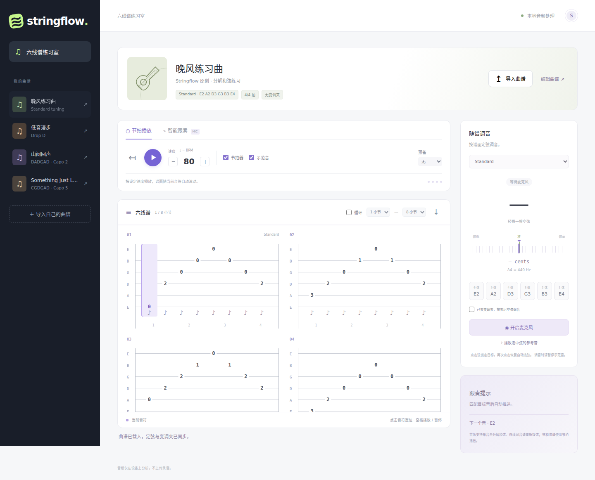

# Stringflow · 六线谱练习室

一个私有的吉他练习网站原型：按节拍播放、听着你的演奏推进六线谱，以及根据谱面定弦与变调夹信息调音。界面支持桌面与手机，音频在浏览器本地分析，不录音、不上传。



## 本地运行

建议 Node.js 24 LTS。

```sh
npm ci
npm run dev
```

打开 `http://localhost:5173`。麦克风需浏览器授权，并要求 **HTTPS 或 localhost**。在手机上通过局域网 HTTP IP 打开时，通常无法调用麦克风；请为手机测试配置 HTTPS。

```sh
npm run build       # 类型检查 + 生成 dist/
npm run preview     # 本地预览生产构建
npm test            # 音高、跟奏状态、谱面解析测试
npx playwright install chromium
npm run test:e2e    # 浏览器测试，包括合成 WAV 麦克风输入
```

线上地址：**https://example.invalid/stringflow/**。网站部署在 `user@example.invalid`，由现有 Nginx 通过 HTTPS 提供服务。GitHub Actions 负责构建与测试；提交代码不会自动发布。

子路径部署使用 `npm run build:site`，资源与首页链接会指向 `/stringflow/`。部署产物保存在服务器 `/path/to/site/releases/`，`/path/to/site/current` 指向当前版本，站点目录中的 `stringflow` 链接指向它。只上传 `dist/` 的内容；仓库源码保持私有。

## 使用

- **节拍播放**：30–240 BPM、0/1/2 小节预备拍、独立的节拍器和合成示范音、暂停与回到起点。BPM 以四分音符为单位；拍号和每个音的时值取自谱面。
- **自动滚谱**：播放高亮当前音符并滚动对应小节，点击音符可定位，支持指定小节循环。空格可播放/暂停；修改速度或循环范围会暂停，点击播放继续。
- **智能跟奏**：打开麦克风，弹出高亮目标音，匹配稳定后推进。支持单音旋律、分解和弦、按设定速度计时的休止。连续同音需要重新拨弦或短暂停音，防止延音导致谱面连续跳过。
- **随谱调音**：根据六根弦的定弦检测音名、频率和 cents 偏差。可自动选择最近的弦，或点击弦锁定。提供 Standard、Drop D、DADGAD、Open G，可在 JSON 中设自定义定弦。
- **变调夹**：默认取下变调夹调空弦，再夹到谱面指定品位。若已夹好，可勾选“按夹后空弦调音”。播放与跟奏始终计入变调夹移调。
- **导入和编辑**：支持 JSON、`.txt` / `.tab` 等时值文本六线谱；可导出 JSON。当前谱子自动保存在浏览器 `localStorage`。内置三首原创练习曲，示例文件见 [examples/](examples/)。

跟奏时示范音和节拍器静音，以避免声音被麦克风误认。启动调音会暂停播放；播放参考音会关闭麦克风，可在听完后重新开启。页面进入后台时自动暂停并释放麦克风。

## 曲谱格式

JSON 支持精确时值、休止、和弦、自定义定弦与拍号：

```json
{
  "version": 1,
  "title": "Drop D 练习",
  "artist": "我",
  "bpm": 80,
  "timeSignature": [4, 4],
  "tuning": [38, 45, 50, 55, 59, 64],
  "capo": 2,
  "events": [
    { "beats": 1, "notes": [{ "string": 6, "fret": 0 }] },
    { "beats": 0.5, "notes": [{ "string": 4, "fret": 2 }] },
    { "beats": 0.5, "notes": [] },
    { "beats": 2, "notes": [{ "string": 3, "fret": 0 }] }
  ]
}
```

`tuning` 为 **6 弦 → 1 弦（低音 → 高音）** 的空弦 MIDI 音高。`string: 1` 是最细的高音弦。`fret` 相对变调夹计数；实际音高为 `tuning[6 - string] + capo + fret`。例如此例的 6 弦 0 品，基础定弦 D2，加上 Capo 2，实际为 E2。

`beats` 以四分音符为 1，支持 0.125 的倍数，空 `notes` 表示休止，同一事件多个音表示和弦。4/4 每小节为 4，6/8 每小节为 3。谱面采用简化节奏符号；精确时值由 JSON 控制，暂不绘制完整附点、连音线或跨小节延音记号。

文本谱示例：

```text
@title 我的第一段旋律
@artist 自定义文本谱
@tempo 80
@time 4/4
@tuning E2 A2 D3 G3 B3 E4
@capo 0
@step 1
e|--0--1--3--0--|
B|--------------|
G|--------------|
D|--------------|
A|--------------|
E|--------------|
```

文本谱按 **1 弦 → 6 弦** 排列，与 `@tuning` 的低到高顺序不同。六行品数按列对齐，每小节字符宽度相同，同列多个音视为和弦。`@step` 指每个起音列的四分音符时值；每小节起音列数 × step 必须等于小节时值。短横线仅作排版间距，不表示休止或额外时长。可连续放置多组六行。

## 实现与边界

采用 TypeScript + Vite，无运行时框架依赖。Web Audio `AudioContext.currentTime` 配合短间隔前瞻调度用于播放，YIN 基频检测用于调音与跟奏。浏览器测试通过虚拟麦克风注入带泛音的 E2 WAV，验证实际 `getUserMedia → AnalyserNode → 音高检测 → 界面/跟奏` 链路。

当前是可运行 MVP，以下能力未实现：

- 图片/PDF 的谱面与调弦标记 OCR，以及 Guitar Pro/MusicXML 导入；调弦标记目前从结构化数据或文本头读取。
- 同时发声的整和弦、多声部、推弦/滑音/击勾弦识别。含整和弦的谱子会明确禁止跟奏，可正常节拍播放。
- 连续演奏中的自动找回位置、跨音符跳转、估计演奏速度的跟随伴奏。当前跟奏是“弹对目标音后推进”，不是完整演奏转录。
- 真实吉他音色采样；当前示范音为合成音。
- 账号、云端曲库、跨设备同步。浏览器只记住当前一份谱子，重要谱子请导出保存。

识别测试覆盖合成音频与浏览器流程，尚未完成真实吉他、不同手机/麦克风、噪声和扬声器串音下的实机验证。调音请单独拨弦并让其他弦静音；真实录音的泛音、环境声和麦克风自动处理仍可能造成误判。

## 代码位置

| 文件              | 职责                                   |
| ----------------- | -------------------------------------- |
| `src/main.ts`     | 界面、播放器调度、交互与麦克风生命周期 |
| `src/score.ts`    | 谱面模型、校验、文本谱解析、内置示例   |
| `src/music.ts`    | 音名、MIDI、频率、定弦换算             |
| `src/audio.ts`    | 音频合成、麦克风输入与资源释放         |
| `src/pitch.ts`    | YIN 基频检测                           |
| `src/follower.ts` | 稳定匹配、同音重拨与推进判定           |
| `tests/`、`e2e/`  | 算法测试、桌面/手机/麦克风浏览器测试   |

浏览器 API 参考：[AudioContext 时钟](https://developer.mozilla.org/en-US/docs/Web/API/BaseAudioContext/currentTime)、[麦克风与安全上下文](https://developer.mozilla.org/en-US/docs/Web/API/MediaDevices/getUserMedia)。
